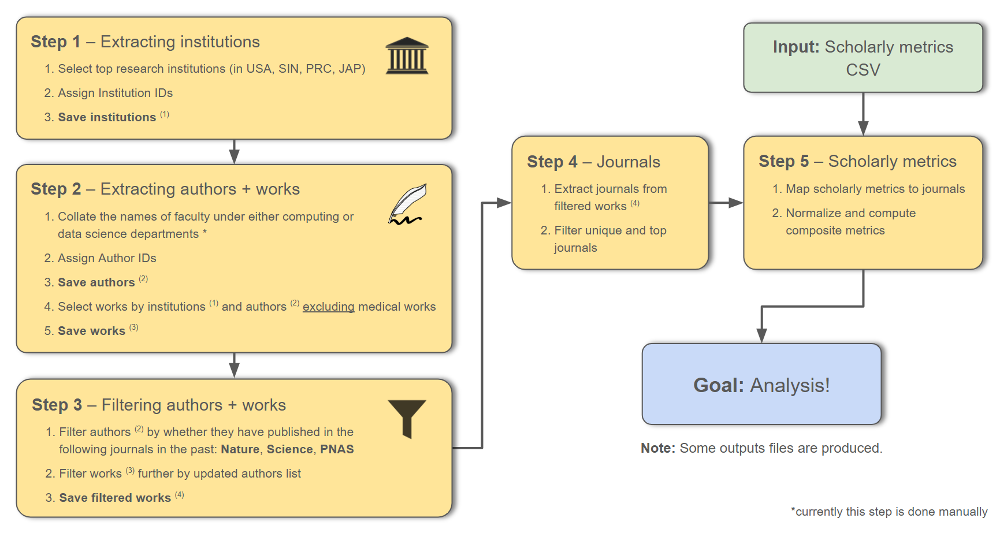

# Journal Study: What are the Top Journals and Conferences in Data Analysis?

## Overview
This study explores the publication venues of top research institutions and universities in data analysis. The goal is to gain a clearer idea of what top researchers in the field implicitly "favor" or "deem" as prestigious journals or conferences.

The analysis is compiled in a single notebook `data_mining.ipynb` with code cells and step-by-step explanations. The structure of the notebook follows the workflow illustrated in the figure.

<div align="center">
  <figure>
    
  </figure>
</div>


## Objectives

These are the study's driving questions, accompanied by the sections in the notebook where they are addressed.

1. **Research University Rankings**
   - (6.1) Which research universities publish the most in data analysis?
   - (6.2) Which research universities have the most faculty publications in *Nature*, *Science*, or *PNAS*?

2. **Publication Preferences and Trends**
   - (6.3) Which journals and conferences are implicitly "favored" by each top university?
   - (6.4) Which journals and conferences do data science faculty at top universities publish in the most (i.e, popularity)?

3. **Publication Metrics and Prestige**
   - (6.5) For each publication metric, what are the top journals and conferences?
   - (6.6) How can journals and conferences be ranked by prestige (e.g., Premium, Leading, Reputable)?

4. **Research Themes**
   - (6.7) What are the dominant themes and keywords in works published by prestigious journals?


## Setup

This notebook primarily uses [OpenAlex](https://openalex.org/); it provides a handy [API](https://developers.openalex.org/) that is available at no cost (with restrictions). Creating an OpenAlex account is **recommended** when running this notebook to increase the number of free API requests per day.

Create the `.env` file and supply your OpenAlex API key (copy the template `.env.example`).

```
OPENALEX_API_KEY=
```


## Project Structure
```
journal-study/
├── data_mining.ipynb
├── faculty/  
├── faculty_ids/
├── metrics/
└── 
└── journal_metrics_2025.csv
└── .env
```


## Contact
For any questions or inquiries, please contact me:
smoting21@gmail.com